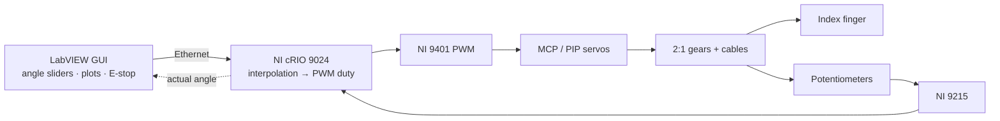

# 🦾 HEXORA: Robotic Hand Rehabilitation After Stroke

> A portable, wearable hand exoskeleton delivering passive-assist therapy for flaccid post-stroke hands.
> **MECH 5030M Team Project · University of Leeds · MEng Mechatronics**
> **My role:** Control Development (embedded control, electronics, GUI, sensing validation), by [Huynh Minh Tuan Le](https://github.com/tuanle163)

[](https://youtu.be/o3KeEM2h4Hs)

🌐 **Live site:** https://tuanle163.github.io/robotics-rehabilitation-project/ &nbsp;·&nbsp; 🎥 **Demo:** https://youtu.be/o3KeEM2h4Hs

<p align="center"></p>

## The problem and aim

Stroke affects ~150,000 people a year in the UK, and 77-85 % suffer upper-limb hemiparesis. **Flaccidity** (weakness and loss of dexterity) is more common than spasticity, and physiotherapy is costly, so patients get too little of it.

**Aim:** design, build and test a **portable** hand rehabilitation prototype giving **active-assistive movement therapy**, with a **graphical user interface**.

## System at a glance



| Requirement | Specification |
|---|---|
| Torque (max) | MCP 1.96 Nm · PIP 0.61 Nm |
| Angular speed | 3.00-3.79 rad/s |
| Range of motion (ROM) | MCP 0-80° · PIP 0-90° |

## 🔁 Key engineering decision: closed loop → open loop

| | Closed loop (original plan) | Open loop + interpolation (final) |
|---|---|---|
| Feedback | Potentiometer through 2:1 gears | Servo's internal loop; potentiometer for GUI display only |
| Problem / benefit | **Gear backlash** made the reading freeze at every reversal and **drift ~4° per cycle** (validated against Optotrak) | Stable, smooth motion bounded by calibrated PWM map and mechanical stops |
| Trajectory | n/a | **Interpolation filter** turns the desired angle into a smooth trajectory (zero speed at start and end) |

With drifting feedback, a closed loop would keep pushing the finger further each cycle. In the interactive illustration it passes the 89.9° MCP safety limit after only 5 cycles.

**Trade-off:** open loop gives up active error correction. Future work: smaller-module gears or a backlash-free joint encoder, then reinstate closed loop.

## 🧪 Results

| Test (open loop) | Demand | Actual | Error |
|---|---|---|---|
| MCP | 70° | 63.5° | −9.2 % (below 89.9° safety limit) |
| PIP | 90° | 106° | below 114.1° safety limit |

- Motion capture validation error: **3.7 %** (jig uncertainty ±2.70°); force gauge accuracy ±0.91 N
- Index finger actuated in passive-assist mode within the safe ROM; cylindrical grasp achieved, tip pinch not achieved

## 🧠 Skills demonstrated

- **Research:** literature review, experiment design and validation, uncertainty quantification, evidence-based design change
- **Engineering:** LabVIEW, NI cRIO/FPGA, PWM, PID, MATLAB, SolidWorks, Optotrak, FEA, FMEA
- **Project:** requirements traceability, risk assessment, contract performance plan, presentations, poster and report

## 📁 Repository

| Path | What |
|---|---|
| `quarto-site/` | Static website (Quarto + Plotly) published to GitHub Pages |
| `app.py` | Original Streamlit version of the portfolio |
| `.github/workflows/publish.yml` | Builds and deploys the site on every push |

### Run locally

```bash
# Quarto site (install Quarto first: https://quarto.org/docs/get-started/)
pip install -r quarto-site/requirements.txt
quarto preview quarto-site

# Streamlit version
pip install -r requirements.txt
streamlit run app.py
```

### Publish

Push to `main`, then in the repo go to **Settings → Pages → Source: GitHub Actions**. The workflow publishes the site automatically.
