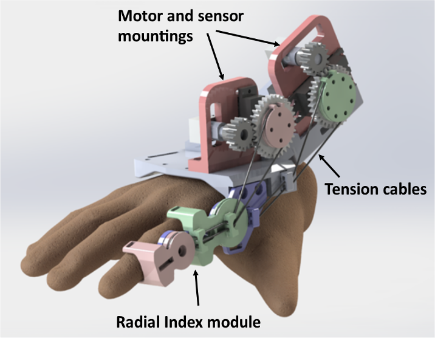

MEng MechatronicsUniversity of Leeds · MECH 5030M Team ProjectControl · Electronics · GUI

<b>150,000</b>UK strokes / year

<b>77-85%</b>hemiparesis of upper limb

<b>5</b>engineers, 3 disciplines

<b>3.7%</b>motion-capture validation error

::: {layout="[[55,45]]" layout-valign="top"}

::: {#first-column}
## The problem

Stroke is a leading cause of disability. Most survivors suffer hemiparesis, and **flaccidity** (weakness and loss of dexterity) is more common than spasticity. Conventional physiotherapy is expensive, so patients receive too little of it. Robotic devices can deliver repeatable, affordable therapy, but many are bulky and clinic-bound.

## The aim

::: {.callout-note}
Design, build and test a **portable** hand rehabilitation prototype giving **active-assistive movement therapy** with a **graphical user interface** to post-stroke patients with hand flaccidity.
:::

## Objectives

1. Hand motion and torque analysis → design specification
2. Follow a design process to develop the exoskeleton
3. **Develop a controller to provide hand rehabilitation motion** *(my focus)*
4. Test the device against the requirements
:::

::: {#second-column}

:::

:::

## Project timeline

| Stage | Output |
|---|---|
| Presentation 1 (Oct 2016) | Literature review, aim, objectives, deliverables |
| Data acquisition | Optotrak motion capture & force-gauge experiments, validated |
| Presentation 2 (Mar 2017) | Design development, FEA/fatigue, electronics, first GUI |
| Final | Prototype build, range of motion (ROM), sensing and functional tests, report & poster |
