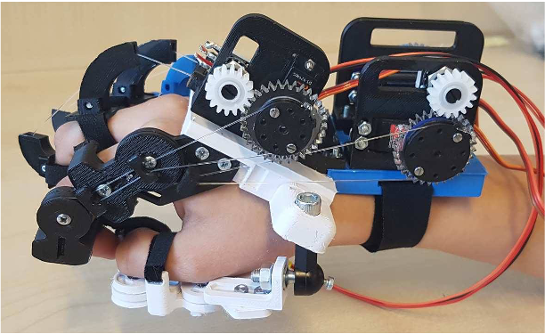
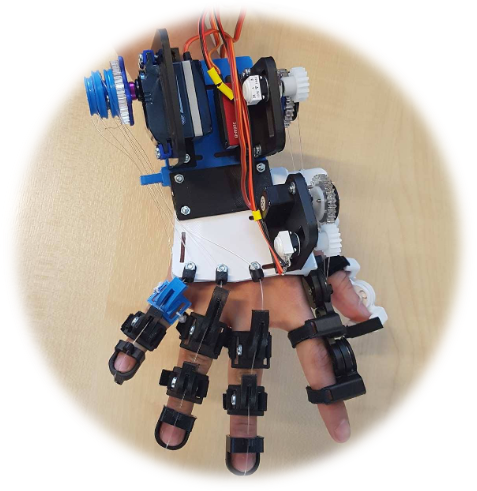

**Control Development** within a 5-person multidisciplinary team (Mechatronics, Mechanical, Medical Engineering), supervised by Dr Andrew Jackson.

::: {.columns}
::: {.column width="50%"}
#### Research skills

- Literature review: stroke impairment, therapy types, hand kinematics, actuation and controller design
- Designed and validated experiments (Optotrak motion capture, force gauge) before trusting data
- Quantified uncertainty (±2.70°, ±0.91 N) and error
- Used evidence (Optotrak vs potentiometer) to overturn an initial design requirement
- Compared admittance and PID control strategies

#### Engineering skills

`LabVIEW` `NI cRIO / FPGA` `PWM` `PID` `MATLAB` `SolidWorks` `Optotrak` `FEA` `FMEA`
:::

::: {.column width="50%"}
#### Project skills

- Requirements → design specification traceability
- Risk assessment (FMEA) and safety-led design
- Contract Performance Plan, weekly meeting minutes, three presentations, poster and report
- Clear technical communication to clinical and engineering audiences
- Honest reporting of trade-offs and limitations

#### Key takeaway

::: {.callout-note}
Good engineering is following the data: when feedback was unreliable, I removed it from the control path.
:::
:::
:::

## Gallery

::: {layout-ncol=3}

:::
