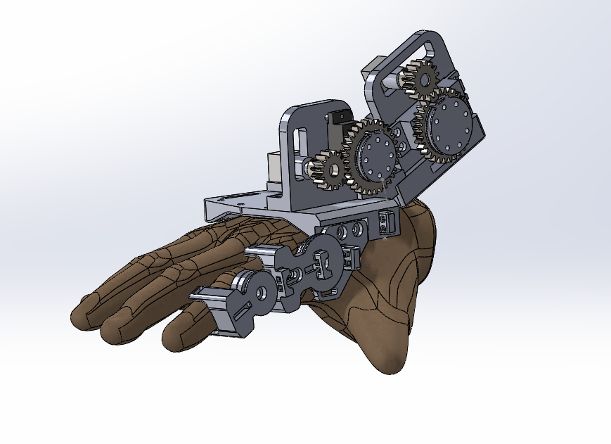
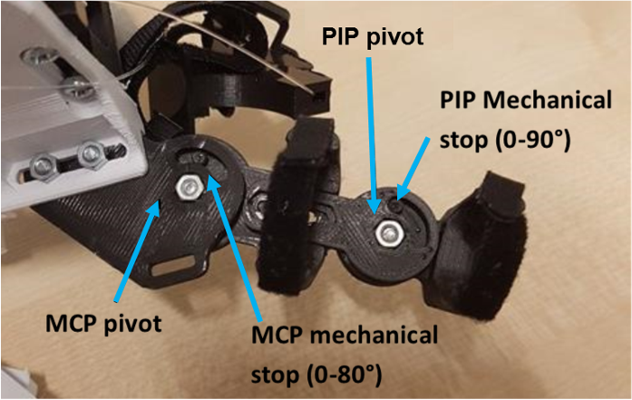

## System architecture

The cRIO sends **PWM** signals through the NI 9401 to the MCP and PIP servos (6 V supply), and reads potentiometer voltages (5 V supply) through the NI 9215.

```{mermaid}
flowchart LR
  GUI["Desktop GUI (LabVIEW)<br/>angle sliders · live plots · E-stop"]
  CRIO["NI cRIO 9024 (real-time + FPGA)<br/>trajectory interpolation<br/>angle → PWM duty"]
  DO["NI 9401<br/>PWM out"]
  AI["NI 9215<br/>analog in"]
  SERVO["Servo motors<br/>(internal closed loop)<br/>MCP · PIP"]
  GEAR["2:1 spur gears +<br/>cable transmission"]
  FINGER["Index finger<br/>MCP + PIP"]
  POT["Potentiometers<br/>(position monitoring)"]
  GUI -->|Ethernet| CRIO --> DO --> SERVO --> GEAR --> FINGER
  GEAR --> POT --> AI --> CRIO
  CRIO -.->|actual angle| GUI
  style GUI fill:#99f6e4,stroke:#0f172a
  style CRIO fill:#fed7aa,stroke:#0f172a
  style FINGER fill:#bae6fd,stroke:#0f172a
```

## Mechanical design

::: {layout-ncol=2}



:::

<div class="cards">
<div class="card-x"><h4>Index finger module</h4>MCP and PIP independently actuated by servos and cable transmission. Range of motion (ROM) 80° (MCP) / 90° (PIP); mechanical stops prevent hyper-flexion/extension; adjustable to hand sizes.</div>
<div class="card-x"><h4>Fingers 3-5 module</h4>One actuator drives three pulley loops: the three fingers move almost identically in grasp/release and tip pinch, so one actuator is sufficient.</div>
<div class="card-x"><h4>Materials</h4>Aluminium alloy for finger parts (safety factor 12.97, ~10⁸ cycles); PLA base for the prototype (~1.08×10⁶ cycles under extreme stress). Chosen on biocompatibility, function and cost.</div>
</div>

::: {.callout-note}
## ROM = Range of Motion
The angle a joint can safely move through, from fully extended (0°) to fully flexed. For this device it is **MCP 0-80°** (knuckle joint at the base of the finger) and **PIP 0-90°** (middle finger joint). Mechanical stops and software limits keep the finger inside its ROM so it cannot hyper-flex or hyper-extend.
:::

## Design requirements derived from experiments

| Requirement | Specification |
|---|---|
| Torque (max) | MCP 1.96 Nm · PIP 0.61 Nm |
| Angular speed | 3.00-3.79 rad/s |
| Range of motion | MCP 0-80° · PIP 0-90° |
| Controller | Originally: closed-loop PID |
